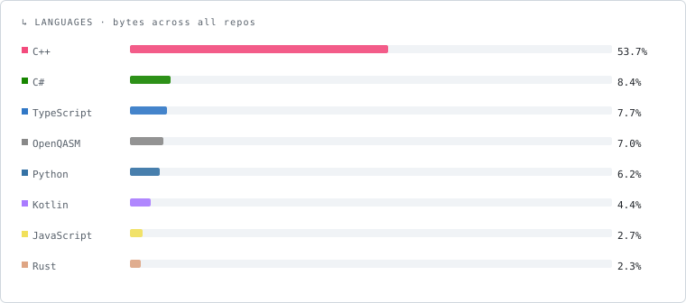
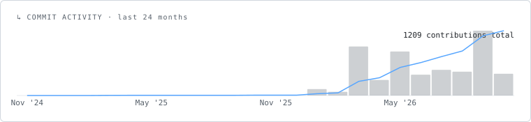

# Sricharan Suresh

Building at the boundary of quantum theory and shipped software:
Ising Hamiltonians, private document tools, tectonic plates.

---

## Research

| | Title | Venue | Status |
|--|-------|-------|--------|
| 01 | [Merit-Order State Preparation for Budget-Efficient MA-QAOA](https://doi.org/10.21203/rs.3.rs-9533781/v1) | Quantum Machine Intelligence (Springer Nature) | Accepted, in production |
| 02 | [Comparative Analysis of Classical and Quantum K-Means Clustering](https://doi.org/10.5281/zenodo.18802705) | Zenodo | Published |
| 03 | Automated Industrial Surface Defect Classification System | – | Seeking venue |

---

## Selected Works

Three clusters of repositories that build on each other. Everything else is in the index on the [portfolio](https://verycareful.github.io/verycareful/#projects).

### lindblad · quantum computing in C++23

- **[lindblad](https://github.com/verycareful/lindblad)** · The framework, and the project everything else orbits. Four simulator backends behind an AUTO selector (statevector with OpenMP, density matrix with exact Kraus channels, Clifford stabilizer tableau, MPS), device-realistic noise from T1/T2 specs, a transpiler with SABRE layout and routing and IBM heavy-hex targeting, and parameter-shift Estimator and Sampler primitives driving VQE, QAOA, MA-QAOA, Grover, Shor, QPE and QFT. OpenQASM 2/3 I/O, optional Python bindings. Source-available, benchmarked head to head against Qiskit Aer.
- **[FLOP](https://github.com/verycareful/FLOP)** · Derivative-free optimizers in C++23, written from the published algorithms: Powell's COBYLA with inequality constraints, and Nelder-Mead. lindblad's variational algorithms call it.
- **[autonne](https://github.com/shek014/autonne)** · Truncated SVD and Hermitian eigendecomposition for small dense complex matrices, the kernels lindblad's MPS backend splits bonds with. A joint project with [shek014](https://github.com/shek014) and [zParik](https://github.com/zParik).
- **uc-quantum** · Factorial study of 42 MA-QAOA variants applied to Unit Commitment in power systems, run on lindblad. Merit-order state preparation reaches a 98.5% success rate at 50 circuit evaluations against 24.0% for simulated annealing, but collapses to 22 to 40% when paired with any other parameter initialisation. Accepted at Quantum Machine Intelligence; [preprint](https://doi.org/10.21203/rs.3.rs-9533781/v1).

### kern · document tools that never touch the network

- **[kernkraft](https://github.com/verycareful/kernkraft)** · The shared Rust core: document formats, PDF page operations (extract, split, merge, rotate, reorder) with MuPDF rendering, and atomic saves. No crate in it may depend on an HTTP, socket or async runtime, and CI checks that.
- **[kern - desktop](https://github.com/verycareful/kern-desktop)** · The desktop app on that core, in Tauri. Early development.
- **[kern - android](https://github.com/verycareful/kern)** · The Android toolkit, with **zero network permissions, not now and not ever**. Reads and writes xlsx, xls, csv, docx, pptx, pdf and epub in place through Android's "Open with", with no app-owned folder and no sync. Kotlin and Jetpack Compose, Apache POI for office formats, MuPDF for PDF.

### Terramax · Minecraft worlds at continental scale

- **[Terramax](https://github.com/verycareful/Terramax)** · A Fabric mod for Minecraft 26.2 that generates worlds from a simulated tectonic plate model rather than from climate noise. Plate centres are scattered by Poisson disk sampling and resolved as a Voronoi diagram; convergent boundaries raise mountains, divergent boundaries open rifts, transform boundaries shear flat. Plates sit around 100,000 blocks apart, so the terrain maths lives in a Minecraft-free core module that a standalone simulator drives.
- **[realworld](https://github.com/verycareful/realworld)** · The smaller mod that came first: vanilla's generator, with the four noises behind Large Biomes lowered an octave so biomes run at 16x vanilla instead of 4x. Released for 26.2 and 1.21.

---

## Stack

**Quantum / ML**

**Systems / Apps**

**Web**

---

## Languages

---

## Activity

---

## Contact

